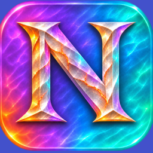
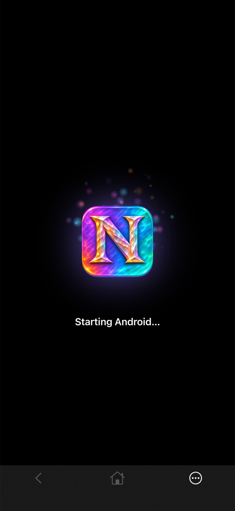
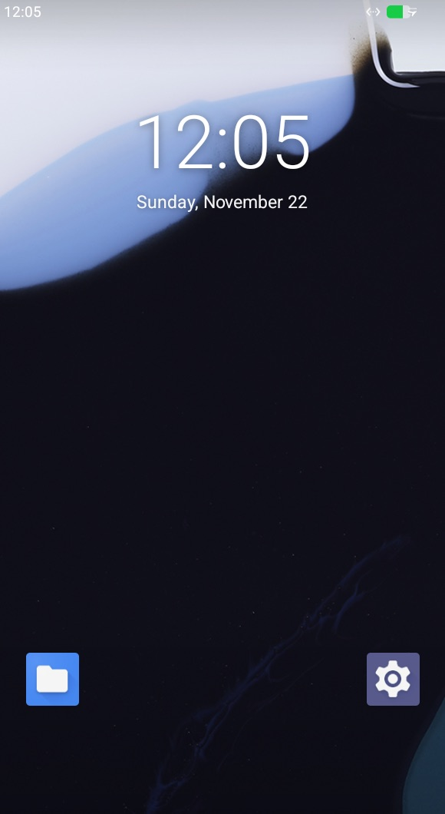
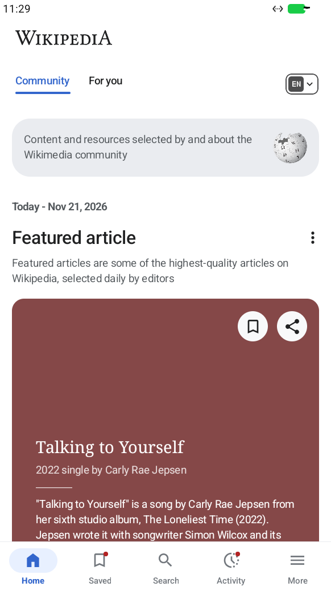
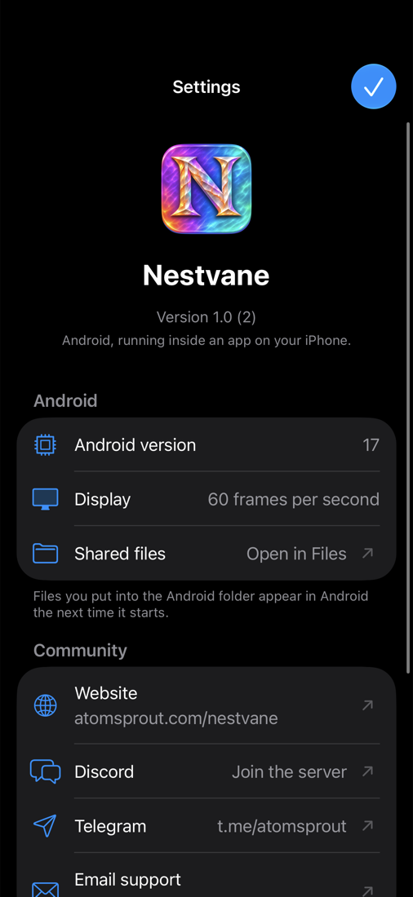
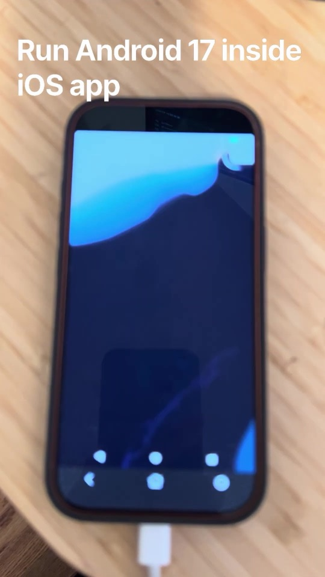
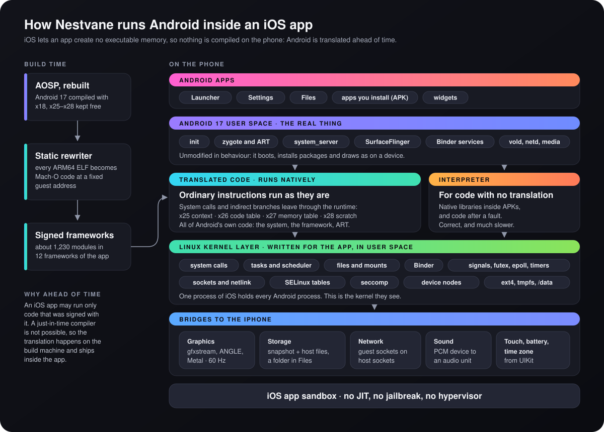

<p align="center">
  
</p>

<h1 align="center">Nestvane</h1>

<p align="center">
  <strong>Android 17, running inside an app on an iPhone.</strong><br>
  No JIT, no jailbreak, no hypervisor.
</p>

<p align="center">
  <a href="https://atomsprout.com/nestvane/">Website</a> ·
  <a href="https://github.com/atomsprout/nestvane/releases">Download</a> ·
  <a href="docs/README.md">Documentation</a> ·
  <a href="https://discord.gg/eGzEaP6TzR">Discord</a> ·
  <a href="https://t.me/atomsprout">Telegram</a> ·
  <a href="README.zh-CN.md">简体中文</a>
</p>

<p align="center">
  
  
  
  
  <a href="LICENSE"></a>
</p>

<p align="center">
  
  
  
  
</p>

<p align="center">
  <a href="https://www.youtube.com/shorts/wDVr3-UY1Ec"></a><br>
  <a href="https://www.youtube.com/shorts/wDVr3-UY1Ec">▶ Watch Nestvane run (YouTube)</a>
</p>

---

Nestvane starts a full Android 17 system, built from the Android Open Source Project, inside an ordinary iOS
app. You install Android apps from APK files, use them with touch, and keep their data between launches.

iOS does not let an app create executable memory, so the usual ways to run another system's code — a
just-in-time compiler, or a hypervisor — are closed. Nestvane takes the remaining road: **Android is rebuilt and
translated ahead of time**, the translated code ships signed inside the app, and a **Linux kernel layer written
for the app** gives that code the system it expects.

> **With thanks to two similar projects.** [Twoyi](https://twoyi.app/) showed that Android translated ahead of time, with
> no JIT, is usable on an iPhone, and Nestvane follows that idea. [Kernarium](https://github.com/imxieyi/Kernarium)
> runs a real Linux kernel on iOS in the open, and was the system to learn from. Nestvane shares no code with
> either and was written from nothing; [how the three compare](docs/comparison.md).

> **For now Nestvane is for developers only.** The only way to run it is to sign the IPA with a paid Apple Developer Program membership (US$99 a year) and sideload it. There is no App Store or TestFlight version, and people without a developer account cannot use it yet. See [docs/installing.md](docs/installing.md).

## What works today

- **Android 17 boots to its launcher** in about 10 seconds, and about 17 the first time after installing: the real `init`, `zygote`,
  `system_server`, SurfaceFlinger, Launcher3, Settings and Files.
- **APK files install and run.** Open an APK with Nestvane from another app, or choose *Install APK…*.
- **Network.** Android apps use the iPhone's Wi-Fi or cellular connection.
- **Shared files.** Android's shared storage is a real folder in the Files app
  (*On My iPhone → Nestvane → Android*).
- **Home-screen widgets**, the phone's battery level and time zone, touch input.
- **Graphics on the GPU** through gfxstream and ANGLE on Metal, at 60 Hz, or at 120 Hz on a ProMotion screen when you
  turn that on in Nestvane's Settings.
- **Text messages you write yourself.** *Send Text Message…* hands Android a sender and a text, and the Messaging app
  shows it as an incoming message. Apps that wait for an SMS, to read a code for example, receive it too. Nothing is
  sent to anyone: Android has no phone number and no radio.
- **An update notice.** Once a day Nestvane asks GitHub which release is the latest and tells you when there is a newer one.
- **Video and sound.** Android's software decoders play a 720p video at its 30 frames a second, and the sound
  comes out of the phone. NewPipe plays a YouTube stream.

## What does not work yet

- **Hardware video decoding, recording and the microphone.** Video is decoded in software; nothing records.
- **Google apps and Play services.** This is AOSP. Apps that need them will not run.
- **Apps with heavy native code are slow**: an app's own native libraries are interpreted.
- IPv6, and live updates of the shared folder (changes made from iOS appear when Android next starts).

[docs/status.md](docs/status.md) has the full list with the measurements behind it.

## How it works

<p align="center">
  
</p>

| Piece | What it does | Where |
| --- | --- | --- |
| **Rebuilt AOSP** | Android compiled with registers `x18` and `x25`–`x28` kept free, so translated code has room for its own state | [`experiments/aosp/patch.py`](experiments/aosp/patch.py) |
| **Static rewriter** | Turns every guest ARM64 ELF into Mach-O code at a fixed guest address. Ordinary instructions run as they are; system calls and indirect branches leave through the runtime | [`experiments/g0/e3/rewrite.py`](experiments/g0/e3/rewrite.py), [`tools/build-native-code.py`](tools/build-native-code.py) |
| **Linux kernel layer** | The kernel Android sees, in user space: tasks, system calls, files and mounts, Binder, signals, sockets, SELinux tables, seccomp | [`runtime/ProbeLinux.cpp`](runtime/ProbeLinux.cpp), [`runtime/ProbeBinder.cpp`](runtime/ProbeBinder.cpp) |
| **Interpreter** | Runs ARM64 code that has no translation, such as the native libraries inside APKs | [`runtime/AArch64.cpp`](runtime/AArch64.cpp) |
| **Bridges to the phone** | Graphics, storage, network, sound, battery, time zone and touch | [`ios/`](ios), [`runtime/HostSocket.hpp`](runtime/HostSocket.hpp), [`runtime/ProbeData.cpp`](runtime/ProbeData.cpp) |

Read more in the documentation:

- [Architecture](docs/architecture.md) — the whole system in one read
- [Static rewriting](docs/static-rewriting.md) — from ELF to code iOS will run
- [The kernel layer](docs/kernel-layer.md) — a Linux kernel in user space
- [Devices](docs/devices.md) — graphics, storage, network and sound
- [Design notes](docs/design-notes.md) — decisions, and the problems that taught the most
- [Building](docs/building.md) and [Status](docs/status.md)
- [Installing the release](docs/installing.md), [Nestvane in numbers](docs/measurements.md), and
  [Nestvane, Twoyi and Andarium](docs/comparison.md)
- [How it was built in four days](https://atomsprout.com/nestvane/blog/android-17-inside-an-iphone-app/), on the blog

## Measured

On an iPhone 15 Pro unless noted. The running record, with every measurement, is [`results/G0.md`](results/G0.md)
(in Chinese).

| | |
| --- | --- |
| Boot to the Android launcher | about 8 s; about 10 s with the media services |
| The same on an iPhone 17 Pro | 9.5–10.9 s; about 17 s the first time after installing |
| Memory footprint | about 2.4–2.6 GB |
| App download | 1.07 GB |
| A finger kept moving on a list | 58–60 frames a second; with 120 Hz on, 111–120 (iPhone 17 Pro) |
| Playing a 1280×720 H.264 video | 30 frames a second, in step with the clock |
| Translated modules | about 1,230, in 12 frameworks |
| Open-source apps installed from APK | 15 |

## Requirements

- iOS 17 or later, on an iPhone with at least 6 GB of memory. Tested on iPhone 14 (iOS 17), iPhone 15 Pro and iPhone 17 Pro.
- Android needs about 2.3–2.6 GB of memory, more than an iPhone 11 gives one app.
- The newer the phone, the faster it runs: Android starts in about 7 seconds on an iPhone 17 Pro and in 12 to 20 on an iPhone 14.
- The [releases](https://github.com/atomsprout/nestvane/releases) carry an IPA with no signature. You sign it
  with your own Apple developer identity; [docs/installing.md](docs/installing.md) says how, and which
  sideloading tools there are. Nestvane is not on the App Store.
- **A paid Apple Developer Program membership (US$99 a year) is needed.** The app must be signed with two
  capabilities, Extended Virtual Addressing and Increased Memory Limit. A free Apple ID does not get the first;
  without it Android takes more than five minutes to start. A way for people without a developer account to run
  Nestvane does not exist yet.

## Building

Building Nestvane needs a Mac with Xcode and XcodeGen, the Android SDK build tools, and an AOSP build made with
the project's patch on a Linux machine. [docs/building.md](docs/building.md) walks through the steps and says
which parts depend on things outside this repository.

```sh
tools/validate-host.sh        # the host test suite: run it before every commit
```

## Repository layout

```
runtime/       the kernel layer, the interpreter, and the entry to translated code
ios/           the iOS app: display, touch, audio, settings
experiments/   the AOSP patch and the static rewriter
tools/         building the guest image and the translated code; validation
fixtures/      guest-side scripts, resource overlays and small test apps
results/       the lab record: what was measured, on which device
docs/          documentation, in English and 简体中文
website/       the website and its blog (Docusaurus, in English); its documents come from docs/
```

## Community

- Website: <https://atomsprout.com/nestvane/>
- Discord: <https://discord.gg/eGzEaP6TzR>
- Telegram: <https://t.me/atomsprout>
- Email: <atomsprout@gmail.com>

Reports of apps that work, and of apps that do not, are the most useful thing you can send.

## License

Nestvane is released under the [Apache License, Version 2.0](LICENSE), the license the Android Open Source
Project itself uses. See [NOTICE](NOTICE).

The license covers what is in this repository. The Android system, gfxstream, ANGLE and SQLite that a built app
contains are separate works under their own licenses.

## Acknowledgements

[Twoyi](https://twoyi.app/) and [Kernarium](https://github.com/imxieyi/Kernarium) came first; what Nestvane owes
them is in [docs/comparison.md](docs/comparison.md).

Nestvane was written by coding agents directed by one person, over five days in November 2026: two days with Codex
(GPT-6.2 Sol), which ended at a ten-minute boot on an interpreter, and two with Claude Fable 5.2, which brought it
to where it is.

Nestvane stands on the [Android Open Source Project](https://source.android.com/), on
[gfxstream](https://android.googlesource.com/platform/hardware/google/gfxstream/) and
[ANGLE](https://chromium.googlesource.com/angle/angle) for graphics, and on SQLite for its data.

Android is a trademark of Google LLC. Nestvane is not affiliated with or endorsed by Google.
