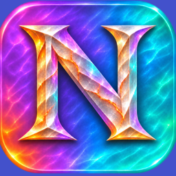
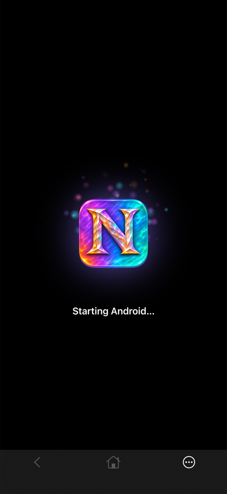
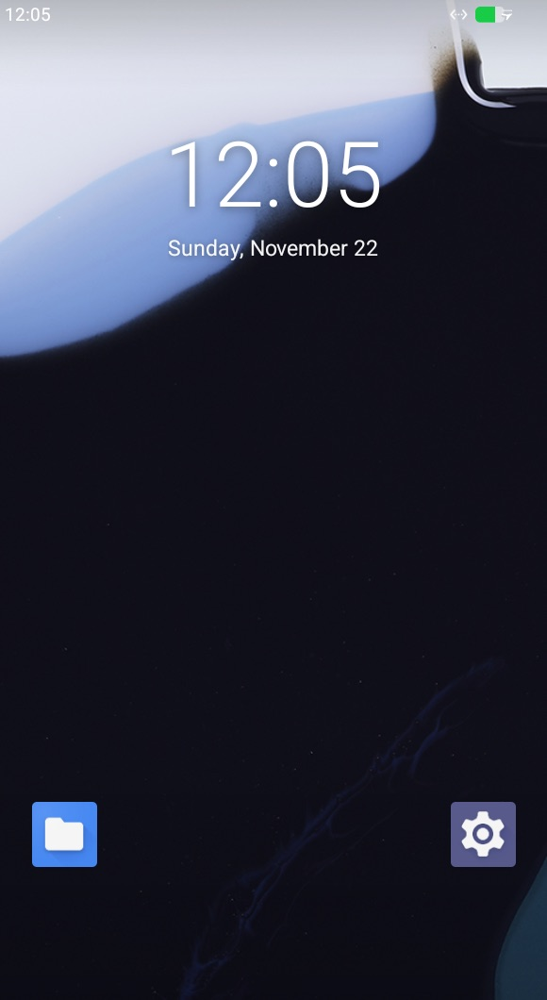
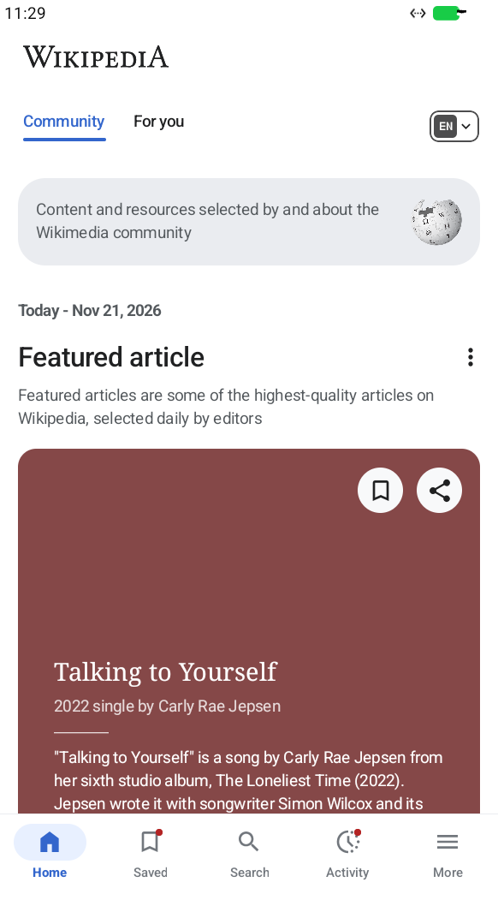
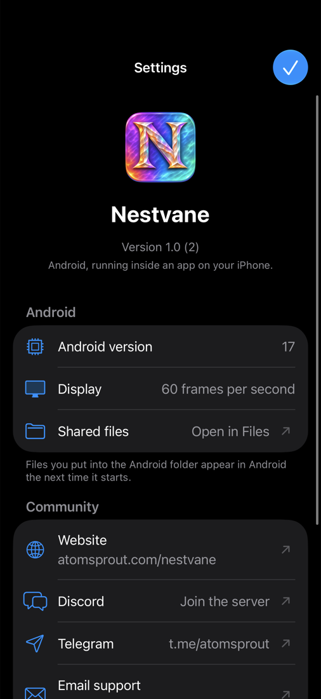
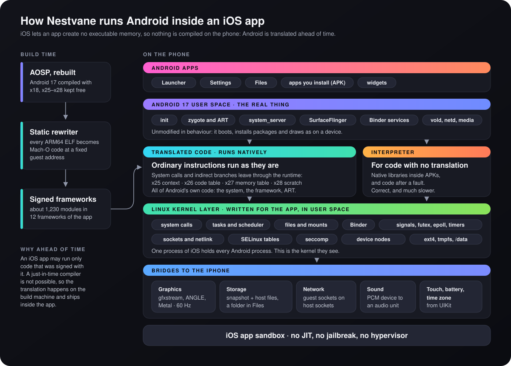

<p align="center">
  
</p>

<h1 align="center">Nestvane</h1>

<p align="center">
  <strong>在 iPhone 的一个 App 里运行 Android 17。</strong><br>
  不用 JIT，不越狱，不用虚拟化。
</p>

<p align="center">
  <a href="https://atomsprout.com/nestvane/">网站</a> ·
  <a href="https://github.com/atomsprout/nestvane/releases">下载</a> ·
  <a href="docs/zh-CN/README.md">文档</a> ·
  <a href="https://discord.gg/eGzEaP6TzR">Discord</a> ·
  <a href="https://t.me/atomsprout">Telegram</a> ·
  <a href="README.md">English</a>
</p>

<p align="center">
  
  
  
  
  <a href="LICENSE"></a>
</p>

<p align="center">
  
  
  
  
</p>

---

Nestvane 在一个普通的 iOS App 里启动完整的 Android 17 系统（由 Android 开源项目 AOSP 构建）。你可以用 APK
文件安装 Android 应用，用触摸操作它们，应用的数据在两次启动之间保留。

iOS 不允许 App 创建可执行内存，所以运行另一个系统的代码的常规办法——即时编译（JIT）或虚拟化——都走不通。
Nestvane 走的是剩下的那条路：**把 Android 重新构建并提前翻译**，翻译好的代码随 App 一起签名发布；再由一层
**专为这个 App 写的 Linux 内核层**，给这些代码提供它们所期待的系统。

> **感谢两个同类项目。** [两仪（Twoyi）](https://twoyi.app/)证明了不用 JIT、只靠提前翻译，Android 就能在 iPhone 上可用，
> Nestvane 走的是这个思路。[Kernarium](https://github.com/imxieyi/Kernarium) 以开源的方式在 iOS 上运行真正的 Linux 内核，
> 是可以学习的那个系统。Nestvane 没有使用它们的任何代码，是从零写的；[三者的对比见这里](docs/zh-CN/comparison.md)。

## 现在能做什么

- **Android 17 启动到桌面**：约 10 秒，安装后的第一次约 17 秒。运行的是原版的 `init`、`zygote`、`system_server`、
  SurfaceFlinger、Launcher3、Settings 和 Files。
- **安装并运行 APK**：从别的 App 用 Nestvane 打开 APK，或者在 Nestvane 里选 *Install APK…*。
- **联网**：Android 应用使用 iPhone 的 Wi-Fi 或蜂窝网络。
- **共享文件**：Android 的共享存储是“文件”App 里的一个真实文件夹（*我的 iPhone → Nestvane → Android*）。
- **桌面小组件**，手机的电量和时区，触摸输入。
- **GPU 图形**：经 gfxstream 和 ANGLE 走 Metal，60 Hz。
- **视频和声音**：Android 的软件解码器能按每秒 30 帧播放 720p 视频，声音从手机放出来。NewPipe 能播放 YouTube 的视频流。

## 现在还不能做什么

- **硬件视频解码、录音和麦克风**：视频是软件解码的；没有任何录制功能。
- **Google 应用和 Play 服务**：这是 AOSP，依赖它们的应用跑不起来。
- **自带大量原生代码的应用很慢**：应用自己的原生库是解释执行的。
- IPv6；以及共享文件夹的实时同步（从 iOS 这边做的改动，要到 Android 下一次启动才出现）。

完整的清单和背后的测量数据见 [docs/zh-CN/status.md](docs/zh-CN/status.md)。

## 工作原理

<p align="center">
  
</p>

| 部分 | 做什么 | 在哪里 |
| --- | --- | --- |
| **重新构建的 AOSP** | 编译 Android 时把寄存器 `x18` 和 `x25`–`x28` 空出来，让翻译后的代码有地方放自己的状态 | [`experiments/aosp/patch.py`](experiments/aosp/patch.py) |
| **静态改写器** | 把客体的每个 ARM64 ELF 变成固定客体地址上的 Mach-O 代码。普通指令原样执行；系统调用和间接跳转经运行时出去 | [`experiments/g0/e3/rewrite.py`](experiments/g0/e3/rewrite.py)、[`tools/build-native-code.py`](tools/build-native-code.py) |
| **Linux 内核层** | Android 看到的内核，运行在用户空间：任务、系统调用、文件与挂载、Binder、信号、套接字、SELinux 表、seccomp | [`runtime/ProbeLinux.cpp`](runtime/ProbeLinux.cpp)、[`runtime/ProbeBinder.cpp`](runtime/ProbeBinder.cpp) |
| **解释器** | 执行没有翻译的 ARM64 代码，比如 APK 里自带的原生库 | [`runtime/AArch64.cpp`](runtime/AArch64.cpp) |
| **通往手机的桥接** | 图形、存储、网络、声音、电量、时区和触摸 | [`ios/`](ios)、[`runtime/HostSocket.hpp`](runtime/HostSocket.hpp)、[`runtime/ProbeData.cpp`](runtime/ProbeData.cpp) |

更多内容见文档：

- [架构](docs/zh-CN/architecture.md)——一篇读完整个系统
- [静态改写](docs/zh-CN/static-rewriting.md)——从 ELF 到 iOS 肯执行的代码
- [内核层](docs/zh-CN/kernel-layer.md)——用户空间里的 Linux 内核
- [设备](docs/zh-CN/devices.md)——图形、存储、网络和声音
- [设计笔记](docs/zh-CN/design-notes.md)——做过的取舍，和最有教益的那些问题
- [构建](docs/zh-CN/building.md)与[现状](docs/zh-CN/status.md)
- [安装发布版](docs/zh-CN/installing.md)、[数字里的 1.0](docs/zh-CN/measurements.md)、
  [Nestvane、两仪和 Andarium](docs/zh-CN/comparison.md)

## 测量数据

除特别说明外均在 iPhone 15 Pro 上测得。逐项的实验记录在 [`results/G0.md`](results/G0.md)。

| | |
| --- | --- |
| 启动到 Android 桌面 | 约 8 秒；加上媒体服务后约 10 秒 |
| 同上，iPhone 17 Pro | 9.5–10.9 秒；安装后的第一次约 17 秒 |
| 内存占用 | 约 2.2–2.7 GB |
| App 下载大小 | 1.06 GB |
| 滑动列表 | 60 Hz 下最高约每秒 55 帧 |
| 播放 1280×720 的 H.264 视频 | 每秒 30 帧，与时钟同步 |
| 翻译的模块 | 约 1230 个，分在 12 个 framework 里 |
| 用 APK 装上的开源应用 | 15 个 |

## 运行要求

- iOS 26 及以上。在 iPhone 15 Pro 和 iPhone 17 Pro 上测试过。
- 别的手机没有测过。Android 需要约 2.2–2.7 GB 内存，超过 iPhone 11 给单个 App 的上限。
- [Releases](https://github.com/atomsprout/nestvane/releases) 里有一个不带签名的 IPA，需要用你自己的 Apple 开发者身份签名，
  做法见 [docs/zh-CN/installing.md](docs/zh-CN/installing.md)。Nestvane 没有上架 App Store。

## 构建

构建 Nestvane 需要一台装有 Xcode 和 XcodeGen 的 Mac、Android SDK 的构建工具，以及在 Linux 机器上用本项目的
补丁构建出来的 AOSP。[docs/zh-CN/building.md](docs/zh-CN/building.md) 逐步说明，并指出哪些步骤依赖本仓库之外
的东西。

```sh
tools/validate-host.sh        # 宿主机上的测试集：每次提交前运行
```

## 仓库结构

```
runtime/       内核层、解释器，以及进入翻译后代码的入口
ios/           iOS App：显示、触摸、音频、设置
experiments/   AOSP 补丁和静态改写器
tools/         构建客体镜像和翻译后的代码；验证
fixtures/      客体里的脚本、资源覆盖包和几个小测试应用
results/       实验记录：测了什么、在哪台设备上
docs/          文档，English 与简体中文
pages/         网站
```

## 社区

- 网站：<https://atomsprout.com/nestvane/>
- Discord：<https://discord.gg/eGzEaP6TzR>
- Telegram：<https://t.me/atomsprout>
- 邮箱：<atomsprout@gmail.com>

哪些应用能用、哪些不能用，是你能给我们的最有用的反馈。

## 许可证

Nestvane 以 [Apache License 2.0](LICENSE) 发布，与 Android 开源项目本身使用的许可证相同。另见 [NOTICE](NOTICE)。

这份许可证覆盖的是本仓库里的内容。构建出来的 App 里包含的 Android 系统、gfxstream、ANGLE 和 SQLite 是各自独立的
作品，适用它们自己的许可证。

## 致谢

[两仪](https://twoyi.app/)和 [Kernarium](https://github.com/imxieyi/Kernarium) 走在前面；Nestvane 从它们那里得到了什么，
写在 [docs/zh-CN/comparison.md](docs/zh-CN/comparison.md) 里。

Nestvane 是一个人指挥编码智能体写出来的，用了 2026 年 11 月的五天：前两天用 Codex（GPT-6.2 Sol），停在靠解释器开机约十分钟；
之后两天用 Claude Fable 5.2，做到了现在的样子。

Nestvane 建立在 [Android 开源项目](https://source.android.com/)之上，图形使用
[gfxstream](https://android.googlesource.com/platform/hardware/google/gfxstream/) 和
[ANGLE](https://chromium.googlesource.com/angle/angle)，数据使用 SQLite。

Android 是 Google LLC 的商标。Nestvane 与 Google 没有隶属关系，也未获其认可。
