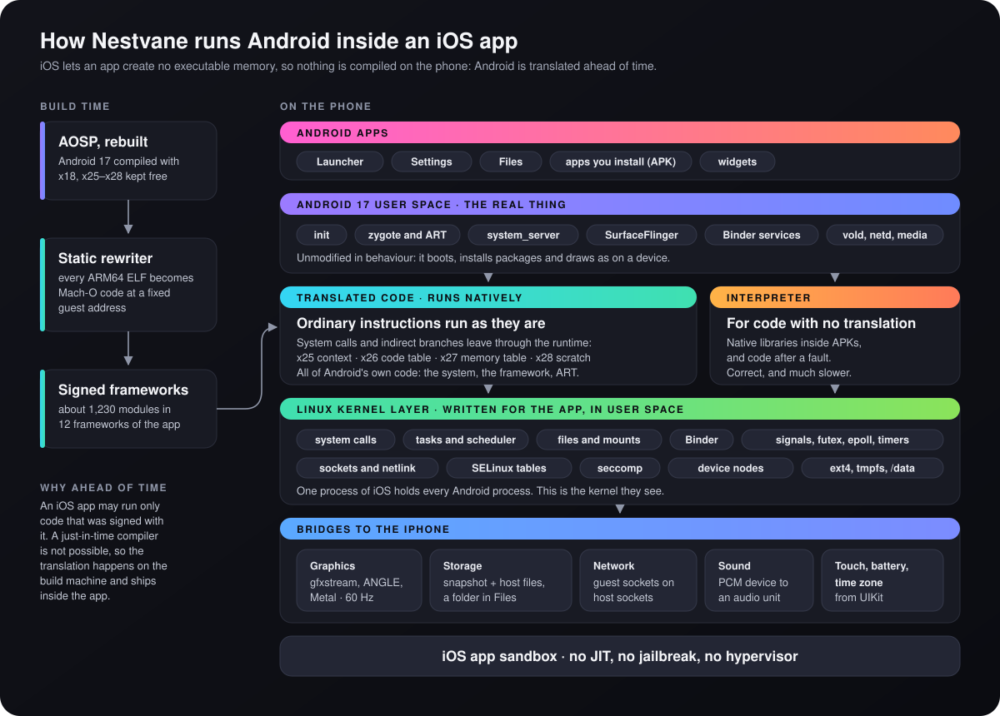
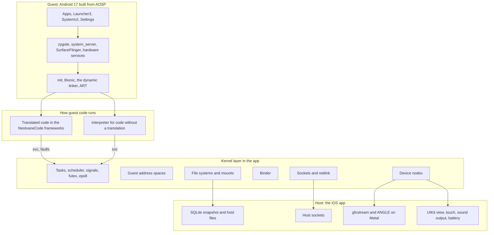
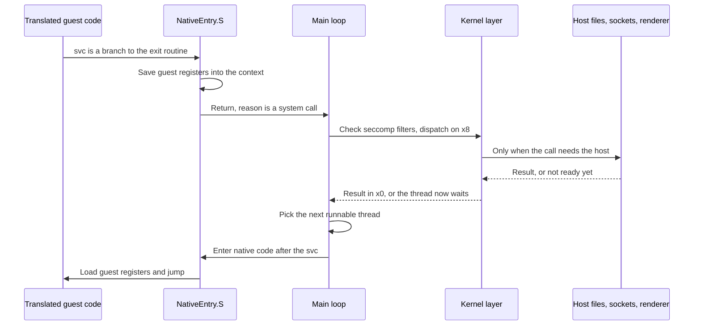

# Architecture

This document describes the whole system in one read.
The other documents go into each part: [static-rewriting.md](static-rewriting.md), [kernel-layer.md](kernel-layer.md) and [devices.md](devices.md).

## The constraint

An emulator or a virtual machine normally relies on one of two things: a hypervisor, which lets guest code run directly on the processor under the control of the host, or a just-in-time (JIT) compiler, which translates guest code into host code while the program runs.
An ordinary iOS app has neither.
There is no hypervisor interface for apps, and iOS does not let an app make memory executable: every page of code that runs must come from a file that was signed when the app was built.

That leaves two ways to run a guest instruction.

- **Interpret it.** A loop in the app decodes each instruction and carries it out. This always works and is slow. An earlier version of Nestvane ran everything this way and needed 606 seconds to reach the Android launcher on an iPhone 15 Pro.
- **Translate it before the app is built.** The guest's machine code is turned into host machine code on the build machine, linked into the app and signed with it. At run time the code is simply there.

Nestvane does the second for the Android system itself, and the first for whatever cannot be known at build time, such as the native libraries inside an app the user installs.

The guest and the host use the same instruction set, ARM64.
So a translation is not a change of instruction set but a rewriting: most instructions are copied as they are, and only those that touch memory addresses, the program counter or the kernel are changed.

## The four pieces

1. **Android rebuilt with reserved registers.**
   Rewritten code needs somewhere to keep its own state: a pointer to the running thread's context, a pointer to the table that maps guest addresses to host memory, and so on.
   Android is compiled from source with the compiler told never to use five registers (`x18`, `x25`, `x26`, `x27`, `x28`), which leaves four of them (`x25` to `x28`) free for the runtime.
   The edits to the AOSP tree are in [`experiments/aosp/patch.py`](../experiments/aosp/patch.py).
   Apart from this and a few switched-off assembly routines, Android's behaviour is unchanged: the real `init`, `zygote`, `system_server`, SurfaceFlinger, Launcher3, Settings and package installer run.

2. **A static rewriter.**
   [`experiments/g0/e3/rewrite.py`](../experiments/g0/e3/rewrite.py) reads a guest ELF file and writes assembly that the Apple toolchain assembles into Mach-O, the format iOS loads.
   [`tools/build-native-code.py`](../tools/build-native-code.py) runs it over every ELF file of the guest root, gives each a fixed guest load address, and links the results into 12 frameworks named `NestvaneCode0` to `NestvaneCode11`.
   About 1,230 modules are translated.

3. **A Linux kernel in user space.**
   Android's programs make Linux system calls. There is no Linux kernel underneath, so the app provides one: [`runtime/ProbeLinux.cpp`](../runtime/ProbeLinux.cpp) implements tasks and scheduling, memory mappings, a file system layer, signals, futexes, epoll, sockets, and the device nodes Android expects, and [`runtime/ProbeBinder.cpp`](../runtime/ProbeBinder.cpp) implements Binder.
   This document calls it the kernel layer.

4. **An interpreter.**
   [`runtime/AArch64.cpp`](../runtime/AArch64.cpp) interprets ARM64 code that has no translation, and single instructions that could not complete natively.
   Translated and interpreted code run in the same process and call each other; [`runtime/NativeCode.cpp`](../runtime/NativeCode.cpp) and [`runtime/NativeEntry.S`](../runtime/NativeEntry.S) manage the crossings.

## The layers

## How a guest process runs

**Memory.**
A guest process has a 39-bit address space, far more than iOS will give one app in total (about 53 GiB with the extended addressing entitlement, shared by all guest processes).
So guest memory is not one block.
[`runtime/GuestSpace.hpp`](../runtime/GuestSpace.hpp) divides the guest address space into 1 MiB chunks and keeps, for each process, a table with one offset per chunk: the host address of a guest address is the address plus the offset of its chunk.
Chunks that the process has never touched have no host memory and an offset that leads to an address nothing can be mapped at, so an access there faults and the fault address still tells which guest address was meant.
Rewritten code performs this look-up itself, inline, before each memory access.

**Loading.**
When the guest calls `execve`, the kernel layer loads the program and Android's dynamic linker as the Linux kernel would.
A translation is valid for one load address only, so the kernel layer places each translated file at the address it was translated for and tells the dynamic linker, through the auxiliary vector, where to put each library.
Once a file's code is mapped where it belongs, that range of the process runs natively.

**Running.**
The main loop picks a guest thread and looks at its program counter.
If the address is in translated code that is mapped in place, it enters the translation ([`nestvane_native_enter`](../runtime/NativeEntry.S) loads the guest's registers and jumps).
Otherwise it interprets.
Native code runs until one of these happens:

| Exit | What follows |
| --- | --- |
| A system call (`svc`) | The kernel layer carries it out. |
| A host fault | The interpreter executes that one guest instruction, or the fault becomes a guest signal. |
| The time slice ends | A watchdog thread sends a signal; it takes effect between two guest instructions. Another thread gets its turn. |
| A jump to code without a translation | The interpreter continues from there until control returns to translated code. |

**Processes and threads.**
`fork` copies the guest address space copy-on-write, using the host's `vm_remap`.
All guest threads are scheduled by one main loop on one host thread.
A thread that has computed for a whole time slice without leaving native code can be handed to one of a few worker threads (three by default) so that it runs on another core, but system calls, faults and signals always come back to the main loop and are handled one at a time.

## The life of a system call

A rewritten `svc` instruction does not trap into any kernel.
It branches to a small routine that saves the guest's registers into the thread's context and returns to the main loop, which calls the kernel layer.

Most calls never reach the host: a `read` from a pipe, a `futex` wake, a Binder transaction or an `mmap` is entirely the kernel layer's business.
A call that cannot complete, such as a `read` on an empty pipe, marks the thread as waiting and returns to the scheduler; the thread is made runnable again when the event it waits for happens.

## Where the devices attach

Each of these is described in [devices.md](devices.md).

- **Graphics.** The guest uses the graphics drivers of the Android emulator. They talk through a pipe device to gfxstream, a renderer that runs in the app and draws with ANGLE on Metal. The app reads finished frames back and shows them.
- **Storage.** The guest's `/data` is kept in a SQLite database written when the guest syncs; large files live in host files. Android's shared storage is a real folder that the iOS Files app shows.
- **Network.** The guest has one Ethernet interface with a fixed private address. Each of its TCP and UDP sockets to the outside is carried by a host socket.
- **Host integration.** Touch goes in through an input device node. The phone's battery level and time zone are shown by Android. An APK opened with the app is installed by Android's own package installer. A sound device exists but is not audible yet.

## What is shipped

The app bundle contains the runtime, the 12 frameworks of translated code, the renderer frameworks, and the guest root as a resource directory.
The guest root is assembled by [`tools/prepare-boot-image.py`](../tools/prepare-boot-image.py), which also removes what the guest has no hardware for.
The app needs two entitlements, extended virtual addressing and an increased memory limit ([`ios/Native.entitlements`](../ios/Native.entitlements)), and iOS 26 or later.
