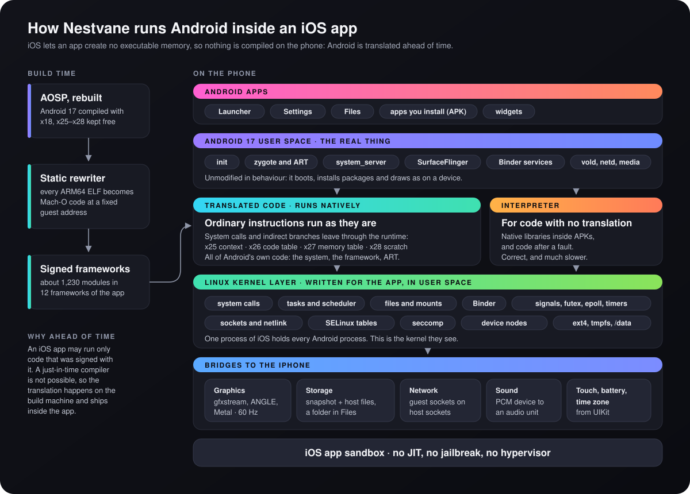
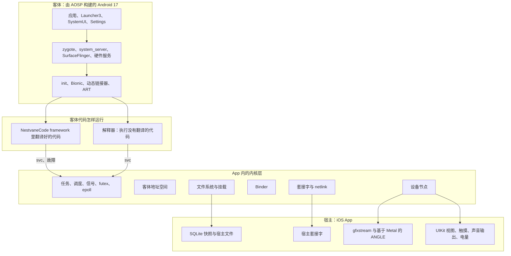
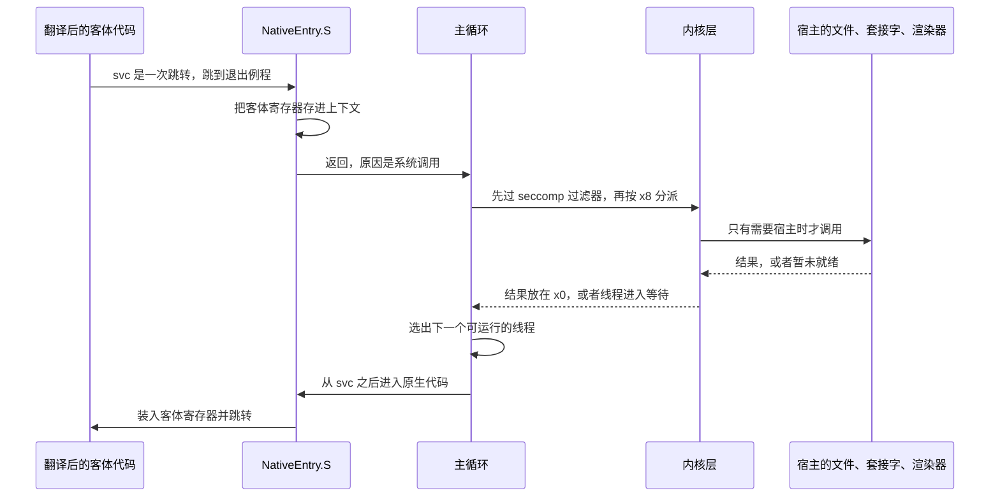

# 架构

这篇文档把整个系统讲一遍。
各部分的细节见其他文档：[static-rewriting.md](static-rewriting.md)、[kernel-layer.md](kernel-layer.md) 和 [devices.md](devices.md)。

## 约束

模拟器或虚拟机通常依赖两样东西之一：一是虚拟化接口（hypervisor），让客体代码在宿主的管控下直接跑在处理器上；二是即时编译器（JIT），在程序运行时把客体代码翻译成宿主代码。
普通的 iOS App 两样都没有。
系统不向 App 开放虚拟化接口，也不允许 App 把内存变成可执行的：每一页被执行的代码，都必须来自构建 App 时签过名的文件。

于是一条客体指令只剩两种跑法。

- **解释执行。** App 里的一个循环逐条解码指令并照着做。这种办法总是可行，但很慢。Nestvane 早期的版本全靠它，在 iPhone 15 Pro 上到 Android 桌面要 606 秒。
- **在构建 App 之前翻译好。** 客体的机器码在构建机上变成宿主的机器码，链接进 App 并一起签名。运行时代码已经在那里了。

Android 系统本身走第二条路；构建时无从知道的东西，比如用户安装的应用里自带的原生库，走第一条路。

客体和宿主用的是同一种指令集 ARM64。
所以这里的翻译不是换指令集，而是改写：大多数指令原样复制，只有涉及内存地址、程序计数器或内核的指令才改动。

## 四个组成部分

1. **带保留寄存器重新构建的 Android。**
   改写后的代码需要地方放自己的状态：指向当前线程上下文的指针、指向“客体地址到宿主内存”对照表的指针，等等。
   Android 从源码编译时，要求编译器永不使用五个寄存器（`x18`、`x25`、`x26`、`x27`、`x28`），其中四个（`x25` 到 `x28`）留给运行时。
   对 AOSP 源码树的修改在 [`experiments/aosp/patch.py`](../../experiments/aosp/patch.py)。
   除此之外，再加上关掉的少数几段汇编例程，Android 的行为没有改变：运行的是原版的 `init`、`zygote`、`system_server`、SurfaceFlinger、Launcher3、Settings 和包安装器。

2. **静态改写器。**
   [`experiments/g0/e3/rewrite.py`](../../experiments/g0/e3/rewrite.py) 读入一个客体 ELF 文件，写出汇编，再由 Apple 的工具链汇编成 iOS 能装载的 Mach-O 格式。
   [`tools/build-native-code.py`](../../tools/build-native-code.py) 对客体根目录里的每个 ELF 文件运行它，给每个文件一个固定的客体装载地址，再把结果链接成 12 个 framework，名为 `NestvaneCode0` 到 `NestvaneCode11`。
   被翻译的模块约有 1,230 个。

3. **用户态的 Linux 内核。**
   Android 的程序发出的是 Linux 系统调用，而底下并没有 Linux 内核，所以 App 自己提供一个：[`runtime/ProbeLinux.cpp`](../../runtime/ProbeLinux.cpp) 实现任务与调度、内存映射、文件系统层、信号、futex、epoll、套接字，以及 Android 期待的设备节点；[`runtime/ProbeBinder.cpp`](../../runtime/ProbeBinder.cpp) 实现 Binder。
   文档里称它为内核层。

4. **解释器。**
   [`runtime/AArch64.cpp`](../../runtime/AArch64.cpp) 解释没有翻译的 ARM64 代码，以及没能原生执行完的单条指令。
   翻译过的代码和解释执行的代码在同一个进程里运行并相互调用，两者之间的切换由 [`runtime/NativeCode.cpp`](../../runtime/NativeCode.cpp) 和 [`runtime/NativeEntry.S`](../../runtime/NativeEntry.S) 负责。

## 层次

## 客体进程怎样运行

**内存。**
一个客体进程有 39 位的地址空间，远多于 iOS 给整个 App 的总量（带扩展寻址权限时约 53 GiB，由全部客体进程共用）。
所以客体内存不是一整块。
[`runtime/GuestSpace.hpp`](../../runtime/GuestSpace.hpp) 把客体地址空间切成 1 MiB 的块，为每个进程维护一张表，每块一个偏移：客体地址加上它所在块的偏移，就是宿主地址。
进程从未碰过的块没有宿主内存，它的偏移指向一个不可能有映射的地址，访问那里必然出错，而出错地址仍能还原出原本要访问的客体地址。
这次查表由改写后的代码自己完成，内联在每次访存之前。

**装载。**
客体调用 `execve` 时，内核层像 Linux 内核那样装载程序和 Android 的动态链接器。
一份翻译只对一个装载地址有效，所以内核层把每个翻译过的文件放在它翻译时设定的地址上，并通过辅助向量告诉动态链接器每个库该放哪里。
文件的代码映射到位之后，进程的这段地址就原生执行。

**运行。**
主循环选出一个客体线程，看它的程序计数器。
如果地址落在已经映射到位的翻译代码里，就进入翻译（[`nestvane_native_enter`](../../runtime/NativeEntry.S) 装入客体寄存器并跳转）。
否则解释执行。
原生代码一直运行到下面某件事发生：

| 退出原因 | 之后 |
| --- | --- |
| 系统调用（`svc`） | 由内核层执行。 |
| 宿主故障 | 解释器执行这一条客体指令，或者故障变成客体的信号。 |
| 时间片用完 | 监视线程发出信号，信号只在两条客体指令之间生效。轮到别的线程。 |
| 跳到没有翻译的代码 | 解释器从那里接着执行，直到控制流回到翻译过的代码。 |

**进程和线程。**
`fork` 用宿主的 `vm_remap` 以写时复制的方式复制客体地址空间。
所有客体线程由一个主循环在一个宿主线程上调度。
一个线程如果在原生代码里算满了整个时间片，可以交给少数几个工作线程之一（默认三个），跑到别的核上；但系统调用、故障和信号总是回到主循环，逐个处理。

## 一次系统调用的经过

改写后的 `svc` 指令不会陷入任何内核。
它跳到一小段例程，例程把客体寄存器存进线程的上下文，回到主循环，主循环再调用内核层。

多数调用根本到不了宿主：从管道 `read`、唤醒 `futex`、一次 Binder 事务或一次 `mmap`，都完全是内核层内部的事。
完成不了的调用，比如对空管道的 `read`，会把线程标记为等待并回到调度器；它等的事件发生时，线程重新变为可运行。

## 设备接在哪里

每一项的细节见 [devices.md](devices.md)。

- **图形。** 客体使用 Android 模拟器的图形驱动。它们经一个管道设备与 gfxstream 通信，gfxstream 是运行在 App 里的渲染器，通过基于 Metal 的 ANGLE 绘制。App 把合成好的帧读回来显示。
- **存储。** 客体的 `/data` 保存在一个 SQLite 数据库里，在客体同步时写入；大文件放在宿主文件里。Android 的共享存储是一个真实的文件夹，iOS 的“文件”App 里看得到。
- **网络。** 客体有一块以太网接口，地址是固定的私有地址。它发往外部的每个 TCP、UDP 套接字都由一个宿主套接字承载。
- **宿主集成。** 触摸经输入设备节点进入。Android 显示手机的电量和时区。用 App 打开的 APK 由 Android 自己的包安装流程安装。声音设备已经有了，但还没有出声。

## 发布的内容

App 包里有运行时、12 个装着翻译代码的 framework、渲染器的 framework，以及作为资源目录的客体根目录。
客体根目录由 [`tools/prepare-boot-image.py`](../../tools/prepare-boot-image.py) 组装，它同时去掉客体没有对应硬件的部分。
App 需要两项权限：扩展虚拟地址和提高内存上限（[`ios/Native.entitlements`](../../ios/Native.entitlements)），系统要求 iOS 26 或更高。
