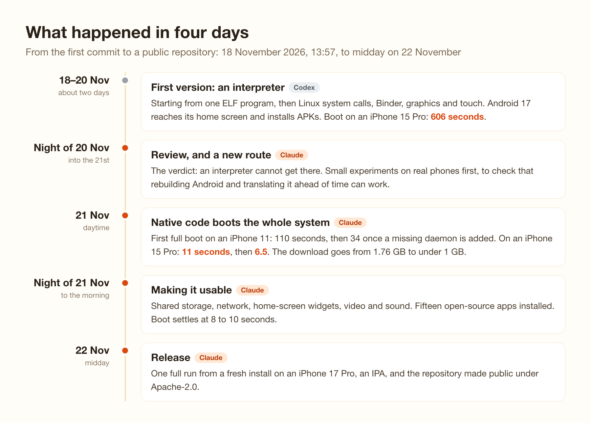
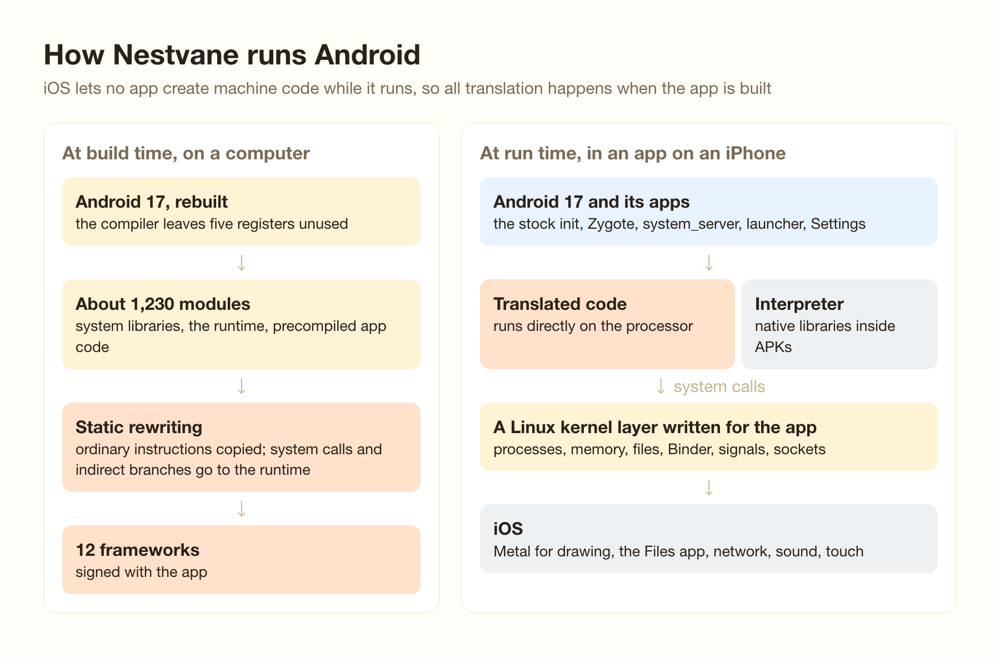
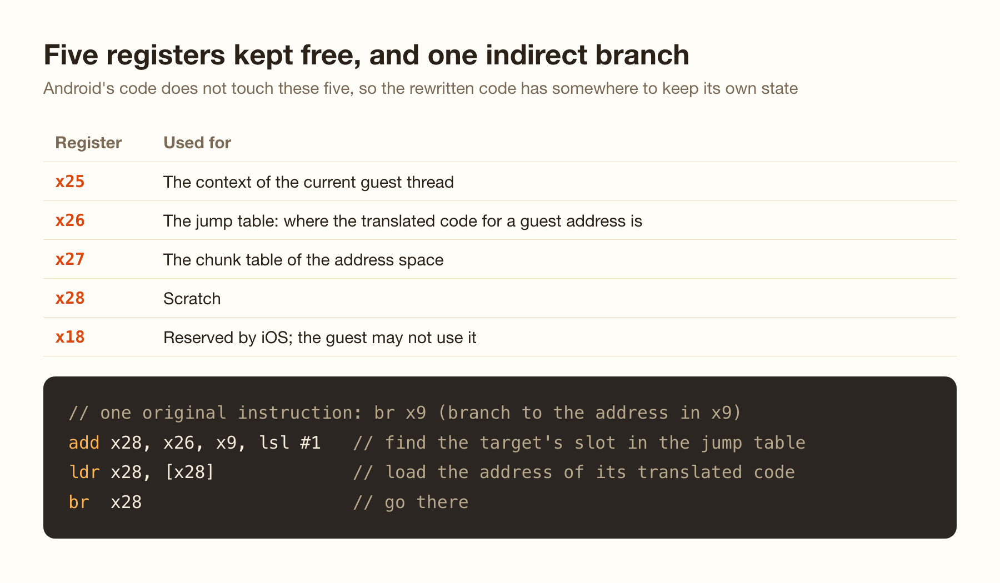
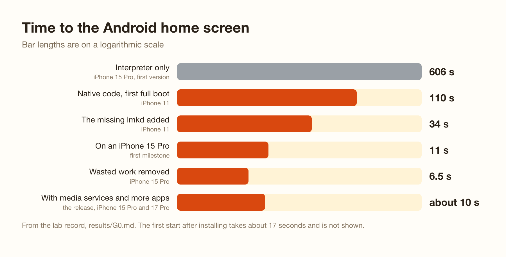
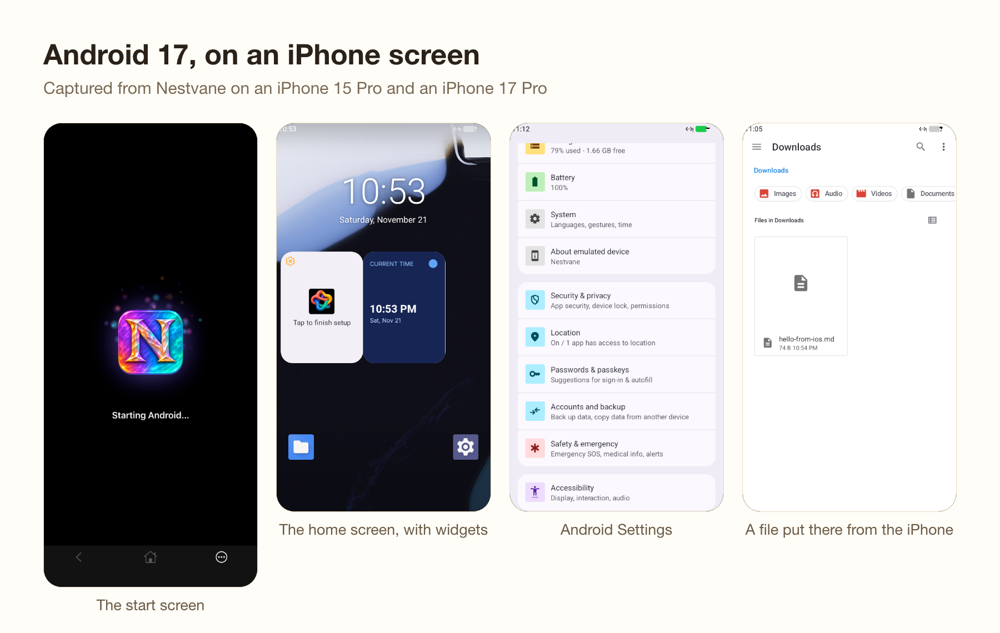
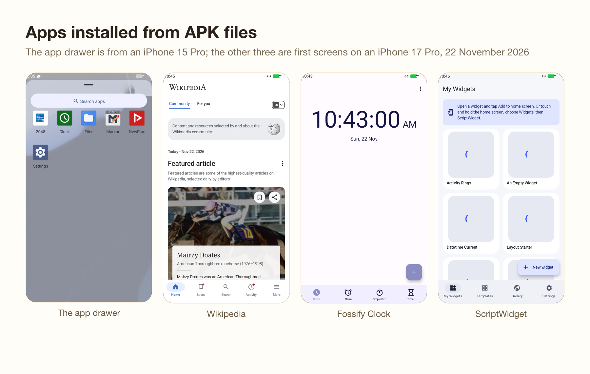
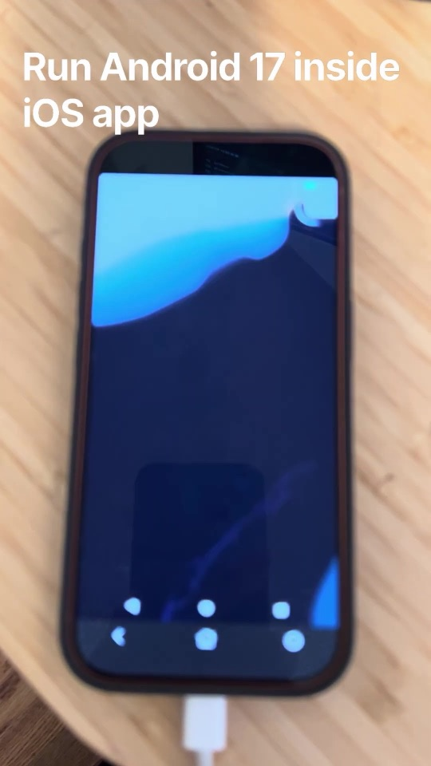

I made an iOS app called Nestvane. Open it and a full Android 17 system starts inside: about 10 seconds to the home screen, and it installs apps from APK files. There is no JIT, and the phone is not jailbroken.

I did not write the code. I directed AI coding agents that did. I do not know Android's internals, and from the first commit to a public repository it took a little over four days.

<!-- truncate -->

The numbers below come from the lab record in the repository, measured on an iPhone 15 Pro and an iPhone 17 Pro.

If you would rather see it first:

- [A short video of it running](https://www.youtube.com/shorts/wDVr3-UY1Ec)
- [The source on GitHub](https://github.com/atomsprout/nestvane)

## How it started

I have written software for Windows, iOS and macOS for many years. I have hardly touched Android.

In November I saw two projects that both ran Android inside an iPhone app: [Twoyi](https://twoyi.app/), and the open-source [Kernarium](https://github.com/imxieyi/Kernarium). What I wanted to know was how far an AI could get on something I do not understand at all.

So I tried.

## Why this is hard

There are two usual ways to run another system's programs on an iPhone, and iOS closes both.

Virtualization is not open to ordinary apps. A JIT is out too: it creates machine code while the app runs, and iOS does not let an app do that.

That leaves the slow ways. Interpret the code one instruction at a time, or translate all of it before the app is packaged. The first is slow to run. The second is a lot of work.

## The first version took ten minutes to boot

For the first two days I used Codex (GPT-6.2 Sol).

It took the interpreter road. First one very simple Android program ran, then whatever was missing was added: processes, files, Binder (what the parts of Android use to talk to each other), graphics, touch. Android's programs believed they were on Linux. The Linux underneath was something we wrote.

After two days Android 17 really did reach its home screen, and it installed APKs.

It just took 606 seconds. On an iPhone 15 Pro, ten minutes.

Later we counted: booting executes about 18.4 billion instructions, and every one of them went around the interpreter's loop. No amount of tuning fixes that.

## Starting over

On the third day I switched to Claude Fable 5.2. I did not ask it to carry on. I asked it to read what existed and say what was wrong.

Its answer was blunt: stop interpreting. Android and the iPhone use the same instruction set (ARM64). Android's code can already run on the iPhone's processor as it is. The problem to solve is how to let it run directly and safely.

It did not start building at once. It ran a few small experiments on real phones first: is the address space large enough, does rewritten code run correctly, can the app recover from a fault, can signed code be loaded on demand. Only when those held did it write the real thing.

## How the new route works

One problem comes first. The translated code needs a few registers (places in the processor that hold data for a moment) for its own state, and stock Android uses every register there is.

The answer is to rebuild Android 17 from source and tell the compiler that five registers are off limits. Android's code keeps its logic and gives up five seats.

Then comes translation. Android has about 1,230 programs and libraries, and each is rewritten, before the app is packaged, into code that iOS will sign. Almost every instruction is copied as it is. Two kinds change: a system call becomes a jump into our runtime, and an indirect branch looks its target up in a table first.

The Linux that Android needs is still our own. It is not a port of the real kernel, only the parts Android uses, a little over twelve thousand lines of C++.

And an interpreter stays. If an APK that a user installs brings its own native libraries, those cannot be translated in advance and have to be interpreted. That is where Nestvane is slowest today; more on it below.

## How 606 seconds became 10

The largest step was the new route itself: the code no longer goes through an interpreter.

Even so, the first full boot on the new route took 110 seconds. For 50 of them nothing happened; the threads were asleep. The cause was silly. Our system image was missing a daemon called lmkd. Android asks for it every time it adjusts a process's priority, and waited 3 seconds each time it was not there. With lmkd added, 110 seconds became 34.

On an iPhone 15 Pro that was 11 seconds. Every second saved after that came from finding work that did not need doing, not from making code faster.

Every time memory was requested, our kernel layer moved all of the process's several thousand memory segments. Touching only the ones affected took 11 seconds to 9.

One line in the log said that 97 graphics shaders had been compiled ahead of time at boot, in 3.9 seconds, while the interface sat waiting. They can be compiled when they are first needed. With that turned off, 9 seconds became 7.

There was no trick to finding these. Put a timestamp on every log line and read down until the times stop adding up.

At its fastest it was 6.5 seconds. Then a pile of media services went in so that video could play, a dozen apps were installed, and it settled at 8 to 10. I did not push it back down. Boot time was never what this project was for.

## Booting is a long way from usable

Booting was only the start. The first few taps turned up a row of problems.

Settings quit as soon as it opened, because the system thought the setup wizard had not finished. The file manager listed nothing, because there was no shared storage. Wikipedia installed and then could not load its front page, because there was no network.

They were fixed one at a time. Android's shared storage is now a folder in the iPhone's Files app: put a file there from the iPhone and Android sees it. Apps use the iPhone's network. Home-screen widgets were kept, and an app's widgets can be added to the home screen.

Video took the longest. The decoder crashed as it started. With that fixed the picture was black. With a picture there was no sound. With sound, playback ran at nine tenths of its speed. In the end a 720p video holds 30 frames a second with the sound in step. The sound was measured by its data rate and level, though. I have not sat down and listened to it properly.

One small episode. On a new iPhone 17 Pro, the first time the app opened, iOS asked whether to let it "find devices on local networks". An app asking that the moment it opens feels wrong. The cause: Android looks up names as soon as it boots, and we were sending those queries straight to the router, which iOS counts as reaching the local network. Now they go through iOS's own resolver and the prompt is gone.

You do not think of a problem like that at a desk. You run into it on a clean phone.

## The last run

Before publishing, I went through everything from the beginning on that new iPhone 17 Pro.

Installing the app took about half a minute. The first start took about 17 seconds, and the ones after it between 9.5 and 10.9. At the home screen it uses 2.2 to 2.4 GB of memory.

Installing an APK takes under half a second. I installed 2048, Fossify Clock, Markor, Wikipedia, NewPipe and ScriptWidget, and all six opened.

*[The demonstration video, on YouTube](https://www.youtube.com/shorts/wDVr3-UY1Ec).*

## Whose ideas these are

Nestvane follows Twoyi's technical approach, above all AOT: no JIT, with Android's code translated to native code when the app is built. Knowing that someone had made that road work mattered a great deal.

Kernarium is open source and runs a real Linux kernel on iOS. Its code and documents were read while Nestvane was planned, and taught a lot.

Nestvane uses no code from either. It was written from nothing. My thanks to both for going first.

## Side by side

This table uses public information only. The Twoyi and Andarium columns (Andarium is Kernarium's Android app) come from their own sites and repositories as read on 22 November 2026. The Nestvane column is what I measured. Where they publish nothing I wrote "not published"; I did not measure for them.

| | Nestvane | Twoyi (iOS) | Andarium |
| --- | --- | --- | --- |
| Android version | 17 | 13 | not published |
| How code runs | translated ahead of time, the rest interpreted | translated ahead of time | interpreter, optional JIT |
| Kernel | a kernel layer of its own | not published | the real Linux 6.18 |
| Boot to the home screen | about 10 s, about 17 s the first time | "about 3 seconds" by its site | not published |
| Requires | iOS 26 or later | iOS 15 or later | iOS 26 or later |
| Installing | sideloaded IPA, paid developer account | sideloaded IPA | sideloaded IPA, about 1 GB |
| Source | open, Apache-2.0 | not published | open, GPL-2.0 |

Do not compare the boot times directly. Twoyi's 3 seconds is what its site says, and it runs Android 13; our 10 seconds is Android 17. The devices differ, the system versions differ, and the stopwatch may start and stop in different places. That Twoyi is much faster than we are is plain all the same.

Andarium uses a real kernel, so its system behaviour is the most complete. We built only what Android uses; what it does not ask for is not there.

One thing a table cannot hold. As far as I know, both projects are the work of experienced Android developers, who understand Android far better than I do, and what they make is more dependable. Nestvane was made by an iOS developer, with the Android side resting on AI and on trying things on real phones again and again. If you want something stable to use, look at theirs first.

What Nestvane can claim is roughly this: the newest Android, 17, and it has run on an iPhone 17 Pro; little was trimmed, so the home-screen widgets, Settings, the file manager and the installer are the stock ones; and all of its source is public under a permissive license.

## The problems right now

The largest is that ordinary users cannot run it.

Nestvane needs an iOS capability that gives it enough address space, and that capability goes only to paid Apple developer accounts, at 99 US dollars a year. I tried signing without it. The app installs and starts, but it can only fall back to interpreting, and after five minutes it had still not reached the home screen.

So the only way in today is to sign the package with a paid developer account and sideload it. That makes it something only developers can play with. How to open it to everyone else, I have not worked out.

Next, speed. An app's own native libraries can only be interpreted, at about forty million instructions a second. ScriptWidget shows it: its interface appears in under a second, but its first widget preview takes about two minutes, because its script engine is a native library.

Beyond that: video is decoded in software and nothing above 720p has been measured; there is no recording and no microphone; there are no Google apps or services; and it has been tested only on two iPhones with 8 GB of memory. Phones with less cannot hold it.

## About the AI

What I did in this project: set the goal, test on real phones, say what was wrong, and choose between roads. The AI wrote the code. The repository has over 550 commits, and the runtime is about twenty-six thousand lines of C++.

The two stages were very different. The two days with Codex produced a version that worked end to end and took ten minutes to boot. The two days with Claude Fable 5.2 first threw out the way code was executed, then brought the boot down to about 10 seconds, and the network, storage, widgets, video and sound all came in that stage too.

This is not a rigorous comparison. It is one project, and the two stages faced different problems; the second stood on what the first had produced. Speaking only for myself, Claude Fable 5.2 is very capable. In a field I barely understand, it got to something publishable in four days.

It has its limits. It needs me to tell it what actually happened on the phone. The permission prompt, the free account that cannot run it: those were hit on a phone, and it could not have thought of them sitting at a computer. Once I saw the app vanish and took it for a crash. It had restarted the app to time a second boot.

So what I take from this is that once the direction is right, the pace is set less by how fast it writes code than by how fast I can bring it real results.

## Where it stands

That is Nestvane 1.0: Android 17, about 10 seconds to the home screen, APKs install, the network works, 720p video plays. Only a paid developer account can install it, and an app's own native code is still slow.

The source, the documents and the record of every step are in the repository, including the ones that led nowhere.
