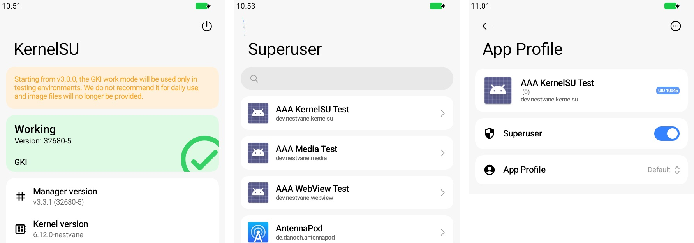

The last post ended at 1.8, with a plan for 1.9 to 2.3. Since then four more releases came out, and the plan changed: someone tried Nestvane properly and wrote down fourteen things that did not work for them, in [issue #5](https://github.com/atomsprout/nestvane/issues/5). Most of what follows comes from that list.

This post goes through 1.9 to 1.12, the one big idea that was measured and dropped, and what comes next.

<!-- truncate -->

The short version: APKs install from Android's own Files app, the shared folder is live, apps see a Wi-Fi network, Android has a low-memory killer, there is a backup of the whole Android, and the official KernelSU Manager works. The start on an iPhone 14 went from 9.1 to about 8.5 seconds.

## The plan changed

The old plan had 2.0 as "no paid developer account". Before building it, it was measured first, to see whether it could work at all. It cannot, not like this. Without the paid account's capability, iOS gives an app about 5 to 6 GiB of address space it can use. Android at its home screen uses about 34 GiB of address space here, because each process maps Android's files for itself. A software MMU would fix the address space, but on code that touches memory a lot it measured about 1.27 times slower, and the start would be 10 to 20 percent slower even with a paid account. So it is shelved, and the numbers are in the repository.

The version numbers changed too. 2.0 is kept for a real breakthrough, and until then releases go 1.10, 1.11 and so on. The order now follows issue #5: first what affects everyone (installing apps, files), then the network and freezes, then root and backups, then the camera.

## 1.9: apps' own libraries, faster

iOS lets no app create machine code as it runs, so the native libraries an app brings with it are interpreted. Since 1.7 a thread that keeps interpreting moves to a core of its own. In 1.8 it still handed itself back to Android's main loop at every floating-point or SIMD instruction, and every time a system library it had called returned.

1.9 keeps it on its core. Every instruction that only changes registers, floating point and SIMD included, goes through the fast path, and returns from system libraries no longer fault. A million random instructions were run both ways with random register contents and gave the same results. On a benchmark the interpreter went from 168 to 195 million instructions a second on the main loop, and from 210 to 242 million on a worker core.

## 1.10: installing apps and moving files

**APKs install from Android's Files app** (issue #5, item 2). Tapping an APK in Files did nothing. The reason was a lock. Apps open shared files through Android's media library, and the media library first asks whether anyone holds a lock on the file, with a kind of lock (`F_OFD_GETLK`) that Nestvane's Linux layer did not answer. The call never returned, so everything opened through the media library waited forever. With the lock implemented, the installer asks, installs and offers to open the app.

**The shared folder is live** (item 1). Files put into *On My iPhone → Nestvane → Android* from the Files app or a computer appear in Android within a few seconds, without restarting it.

**Pictures and videos open** (item 9). Android here had no app to open them. A small viewer now does.

**APKs from other iOS apps** (item 3) are recognized by their content, so a file shared under another name installs too. And there is a **Recent Apps** key next to Home (item 7).

## 1.11: network, recordings and freezes

**Apps see Wi-Fi** (item 4). Android's network was Ethernet, and many apps count only Wi-Fi and cellular as being online. It is now reported to apps as a connected, validated Wi-Fi network.

**IPv6** works where the phone's network has it.

**Export Diagnostics** (item 10). Some freezes could not be reproduced here, so the More menu now writes one text file with what every Android thread is waiting for, memory, the system server's Java stacks and Android's recent log, ready to attach to a report.

The first diagnostics report found a real cause of freezes. Android's low-memory daemon, `lmkd`, had stopped at its very first system call in every version so far, so Android never knew which apps it could end. When the address space filled up, a new app could not start, and the app you tapped never opened. `lmkd` runs now, and when a new process finds no room, the cached app Android ranks lowest is ended first.

**A faster start.** The new features first made the start slower, and the rule is that a release may not start slower than the one before. Profiling found three things: every `close` woke every waiting thread (26,000 times before the home screen), the table that finds translated code was written to its file one system call per page, and two lookups walked lists of thousands of entries. With those fixed, the start went from 8.7 to 8.4 seconds.

One thing was built and left out: Android's Wi-Fi service. It worked, but it made the start 0.3 seconds slower, and since apps already see Wi-Fi, only apps that talk to the Wi-Fi service directly need it. It moves to 1.14, started after the home screen is up.

## 1.12: backups and KernelSU

**A backup of the whole Android** (item 12). More → Back Up Android saves Android's apps, their data and its settings in one file, kept wherever you choose. More → Restore Android puts one back. What Android had before is kept until Android reaches its home screen from the backup, and is put back if it does not. An iPhone backup already includes Android's data, so this one is deliberately small: it is for going back to a moment, or moving only Android. On an iPhone 14, 507 MB of data made a 331 MB file, and restoring it took under a second.

**KernelSU** (item 5). Nestvane has had root since 1.7: when an app runs `su`, iOS asks you, and Nestvane's Linux layer gives the app root. KernelSU works on the same idea. Root is decided in the kernel, and its Manager app talks to the kernel through a private driver. So instead of porting anything, Nestvane's Linux layer now answers KernelSU's driver itself, written from KernelSU's published interface.

Install the official KernelSU Manager and it says **Working**. Its Superuser tab lists your apps, and each has a switch. The switches and the iOS prompt keep one set of answers: allow an app in either and the other shows it allowed. The Manager is recognized by the certificate its APK is signed with, the same check KernelSU does, so a look-alike app cannot take its place. Modules do not work yet: nothing runs KernelSU's `ksud` while Android starts.

Getting there found two bugs that had nothing to do with KernelSU:

- **No program in `/data` could ever run.** The Manager runs its own tool from its app's native library folder, and got "Permission denied". The files under `/data` are kept by Nestvane's Linux layer in a different form from the system image, and starting a program only accepted the system image's kind. Terminal apps and many root tools run programs this way too.
- **Ending a process with SIGTERM could hang the sender.** When the target handled SIGTERM itself, the call was never finished. The Manager hit it while closing a root shell and sat on its splash screen forever.

There is a guide to all of this now, [Using Nestvane](/docs/using/), with KernelSU step by step.

## Start time

The rule from the last post still stands: before a release, Android is started six times on an iPhone 14, and the median of the last five may not be slower than the recorded number for the version before.

| Version | Median of five starts, iPhone 14 |
| --- | --- |
| 1.8 | 9.1 s |
| 1.9 | 9.0 s |
| 1.10 | 8.7 s |
| 1.11 | 8.4 s |
| 1.12 | 8.5 s |

1.12 needs an explanation. The first check was 0.25 seconds slower than 1.11, so 1.11 and 1.12 were installed in turn on the same phone: 1.12 was really about 0.4 seconds slower. Neither new feature ran during a start. What had changed was the layout in memory. The new KernelSU fields were added in the middle of the structure that holds the Linux layer's state, which moved every field after them. With the new fields moved to the end, 1.12 started in 8.55 and 8.50 seconds against 1.11's 8.75 and 8.58, taken in turn. The final check was 8.47 seconds. That is 78 milliseconds over the number recorded for 1.11, but the phone was slower that afternoon, so the recorded number stays at 1.11's.

## What comes next

| Version | Goal |
| --- | --- |
| 1.13 | The front camera, and photos and videos that save (issue #5, item 14) |
| 1.14 | Android rebuilt: a tablet layout on the iPad, hardware video decoding, a home screen that turns, the Wi-Fi service started after the home screen |

The rebuilt Android in 1.14 needs the build machine back from its snapshot first, which is why those items wait together.

What has not changed is the biggest problem: running Nestvane still needs a paid Apple developer account. And apps whose work is in their own native libraries remain slow, because those libraries are interpreted. Both are what 2.0 is kept for.
