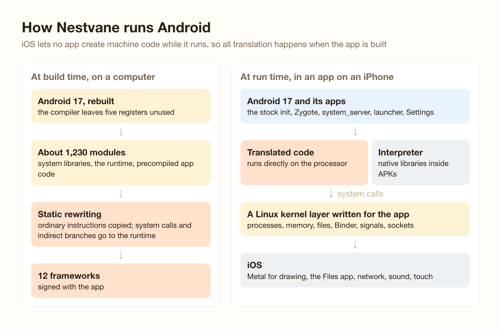
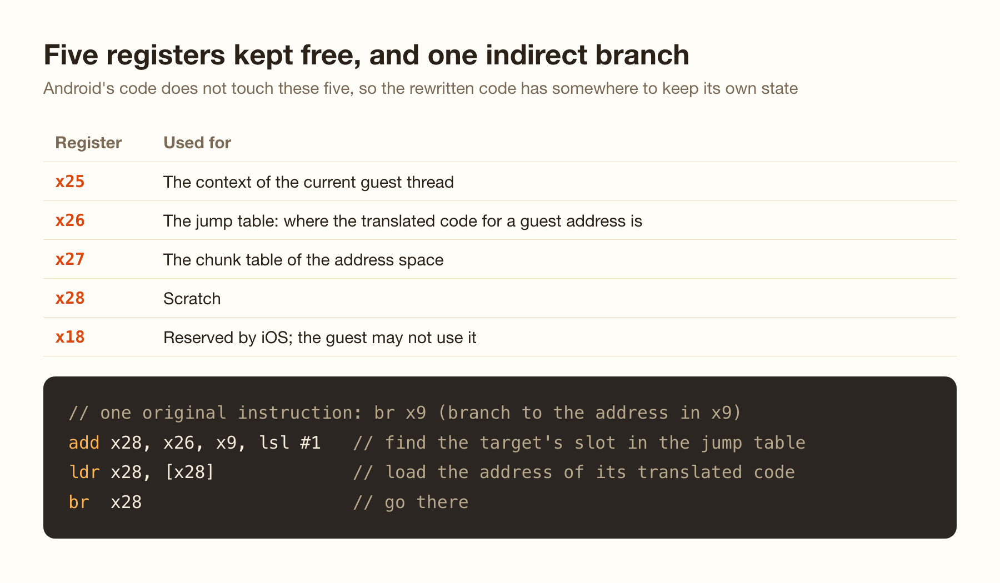

The earlier posts were about what happened: how Nestvane came to be, and what each release changed. This one is about how it works. Why it is built the way it is, what each part does, what was simplified on purpose, and where the design stands now, at 1.12.

<!-- truncate -->

The short version: Android and the iPhone use the same instruction set, so Android's code is not translated into another language but rewritten in place, on the build machine, and signed into the app with everything else. The Linux kernel Android expects is not there, so the app contains one of its own. The only code that is interpreted is code nobody could know about when the app was built.

## The constraint everything follows from

An emulator or a virtual machine normally relies on one of two things.

- A **hypervisor** runs the guest's code directly on the processor and steps in when it touches something it should not. iOS gives ordinary apps no hypervisor.
- A **JIT** translates the guest's code into the host's while it runs. iOS does not let an app make memory executable: every page of code that runs must come from a file that was signed when the app was built.

That leaves two ways to run one of Android's instructions: interpret it, or translate it before the app is signed. Interpreting always works, and it is slow. The very first version of Nestvane interpreted everything and took 606 seconds to reach Android's home screen on an iPhone 15 Pro. Booting runs about 18 billion instructions, and no interpreter loop is fast enough for that.

So the design splits the work by one question: **is the code known when the app is built?**

- Android itself, about 1,230 programs and libraries, is known. It is translated ahead of time.
- The native libraries inside an APK you install later are not. They are interpreted.



## Rewriting, not translating

Android on phones is ARM64, and so is the iPhone. A translation here does not change one instruction set into another. Almost every instruction can stay exactly as it is.

What cannot stay is anything that depends on *where* things are:

| In Android's code | Why it cannot run as it is | What the rewriter puts there |
| --- | --- | --- |
| A load or store through a pointer | A guest address is not a host address | Look the address up first, then do the same access |
| `adr`, `adrp` (addresses relative to the program counter) | The translation lives somewhere else | The guest address as a constant |
| `br`, `blr`, `ret` (jumps to an address in a register) | The register holds a guest code address | Look up where that instruction's translation is, then jump |
| `svc` (a system call) | It must not reach the iOS kernel | A jump into Nestvane's own kernel layer |
| Reading or writing the thread pointer | It belongs to the guest thread, not the host one | A load or store in the thread's context |

Everything else, which is most of the code, is copied unchanged. The rewriter is a Python script of about 800 lines. It reads an ELF file, walks its code four bytes at a time, and writes assembly that Apple's toolchain turns into Mach-O. The results are linked into 12 frameworks and signed with the app, so at run time the code is simply there, like any other code in the app.

## Five registers set aside

Each rewritten sequence needs a few registers of its own: one pointing at the running thread's state, one at the table of where memory is, one at the table of where code is, and one to work in. If Android's code used every register, the rewriter would have to save and restore registers around each sequence, or analyse every function to find a free one.

Instead, Android is compiled from source with the compiler told never to touch five registers:

```
-ffixed-x18 -ffixed-x25 -ffixed-x26 -ffixed-x27 -ffixed-x28
```



| Register | Used for |
| --- | --- |
| `x25` | The running guest thread's context |
| `x26` | The code table: guest instruction address to translated code |
| `x27` | The memory table of the process |
| `x28` | Scratch |
| `x18` | Nothing. iOS may clear it at any moment, so guest code must not depend on it |

Why not take a stock Android image and save the build? Because it was measured first. In the stock Android 17 image about 6% of instructions use `x25` to `x28`. The one register it leaves almost alone, `x18`, is not kept by iOS: a value written there was lost on every system call, and sometimes in the middle of plain arithmetic (941 times in 55,117 trials on an iPhone 15 Pro) when the thread was preempted.

The flag is not the whole job. Bionic's `setjmp`, ART's compiler and its entry code, and libraries with hand-written assembly (BoringSSL and the copies of it inside Cronet, parts of TensorFlow Lite) all had to be changed or built from their C paths. An audit script disassembles the built tree and lists any file that still names a reserved register. Losing the registers cost nothing measurable on benchmarks.

## Memory: a table of chunks

A guest pointer is an Android address, and Android expects a lot of address space. At the home screen in the reference emulator, 117 processes had reserved about 1,500 GiB of addresses between them; the allocator alone reserves 8 GiB in every process. An iOS app gets about 53 GiB in total, and only with a paid developer account's extended addressing entitlement.

So guest memory is not one block. Each process's address space is cut into 1 MiB chunks, and a table holds, for each chunk, the offset to the host memory behind it. A memory access becomes three instructions in front of the original one:

```
ubfx x28, xN, #20, #19     // which chunk
ldr  x28, [x27, x28, lsl #3]  // that chunk's offset
add  x28, x28, xN          // the host address
```

Chunks that were never touched have no host memory at all, and their offset leads to an address where nothing can be mapped. An access there faults, and the fault still says which guest address was meant, so the kernel layer can give it memory and retry. Runs of chunks have guard pages on both sides, so a pointer that strays faults instead of reaching some other process's memory.

Two shortcuts keep it cheap. The stack pointer holds a host address, so the tenth of all instructions that use the stack need no rewriting. And an access through the same register as the one before reuses the address it already has.

## Jumps go through a table, and so does safety

When code jumps to an address in a register, the address is a guest one. The translation looks it up in the code table, which has one entry for every guest instruction, and jumps to what it finds. Returns go through the table too: the link register keeps the guest's return address, so ART can walk its stacks unchanged. That costs about one percentage point.

The table is also how control flow is kept in bounds. A module's part of the table only exists once the process has really mapped that module at its address. A jump anywhere else faults on the look-up, which is a data access, before control goes anywhere.

That detail came from iOS. The first design marked special places with invalid addresses and caught the jump. On a Mac that worked; on iOS the process was killed outright, because jumping to an address that is not signed code is a code-signing violation, and it cannot be caught. Now every entry code can jump through is real code, a small stub that hands the address to the runtime.

## Every file has one address

Because guest addresses are baked into the translation as constants, a library must be loaded exactly where it was translated for. Android normally loads libraries at random addresses, so:

- the build gives every file a fixed address, kept from build to build so that adding a file does not force everything to be translated again;
- files are recognised by a hash of their content, not by path, since the same library can exist under twenty paths;
- Android's dynamic linker is patched to ask where a file belongs. The answer comes in two extra entries of the auxiliary vector. On a real Linux kernel those entries are absent and the linker behaves as usual, so the same image still boots in Google's emulator, which is how every change is checked against a real kernel.

## A Linux kernel inside the app

Android's programs ask the kernel for everything: memory, files, threads, timers, sockets, and Binder, through which Android's processes call each other. Inside an iOS app there is no Linux kernel to ask. So Nestvane has its own implementation of the Linux system call interface, in ordinary C++, which these posts call the kernel layer. It is about 13,500 lines in one file, plus Binder, the `/data` store and the network pieces around it.

It is not a port of Linux. It is written from how the interface behaves: what each call returns, in what order things happen, what `/proc` and `/sys` contain. A few principles run through it.

**Follow Linux exactly where Android depends on it.** Seccomp filters run on every system call, as on Linux, because Android installs them on apps and media services and a filter that behaves differently changes what a process may do. Mount namespaces propagate mounts between them, because Android's storage daemon mounts in one namespace and every app must see it in its own. Binder is a full driver: transactions, references between processes, passing file descriptors, death notifications. Android's own `servicemanager` and everything above it run on it unmodified.

**Give a fixed answer where Android only needs an answer.** SELinux is enforcing, and Android asks it questions all the time. There is no policy engine: the answers were captured from a real kernel when the system image was built and are served from tables. Shared storage on Android is a FUSE file system served by the media provider; here the FUSE mount is simply a view of the folder, and the daemon receives its first message and nothing after. Both are written down as limits: a decision that was not captured is not there, and shared storage has no per-app access control.

**Stop loudly on what is missing.** An unknown system call is not answered with an error and forgotten. The calling process is stopped and the call is named in the log. A wrong answer tends to show up much later as some unrelated failure; a stop names the cause.

**One thread for the kernel.** Every system call of every Android process runs on one host thread, one at a time. The kernel layer needs no locks, and a long list of hard bugs never exists. Threads that only compute can move to other cores (below), and come back for their next system call.

A system call is cheap in this design. The rewritten `svc` saves the guest's registers and returns to the main loop, which checks the seccomp filters and calls the kernel layer. Most calls never leave it: a pipe read, a futex wake, a Binder transaction or an `mmap` is the kernel layer's own business. Only files, network and graphics reach iOS.

## The interpreter, and mixing the two

The native libraries an installed app brings with it were not known at build time, so they have no translation. They are interpreted, in the same process as translated code.

Those libraries are placed in a fixed 1 GiB range of guest addresses that the code table covers with no entries. When translated code calls into one, the table look-up faults, the interpreter takes over at that address, and native execution resumes as soon as control comes back to code that has a translation. The same mechanism handles a single translated instruction that faults (its memory not there yet, say): the registers are still as they were before it, so the interpreter runs just that one instruction and native code carries on.

Mixing has a catch that took a while to see. Translated code can run every instruction the processor has, so the interpreter must know every instruction translated code might be in the middle of when a fault hands it over, not only what app libraries contain. A gallery app once stopped dead because the interpreter met a timer read it had not been taught.

The interpreter has had most of the speed work since 1.0. Common instructions are decoded once into a form that runs directly, a thread that keeps interpreting moves to a core of its own, and since 1.9 even floating-point and SIMD instructions stay on that core. Each fast path was checked against the plain interpreter with hundreds of thousands to a million random instructions. It is still the slowest part of Nestvane by far: apps whose work is in their own native libraries, games and some script engines, are much slower than apps written in Java or Kotlin.

## Devices

The kernel layer presents device nodes, and behind some of them is the iPhone:

- **Graphics.** Android uses the graphics drivers of Google's emulator. They talk through a pipe device to gfxstream, a renderer running in the app that draws with ANGLE on Metal. Finished frames go to the screen as surfaces on the graphics processor, at up to 120 Hz.
- **Storage.** `/data` is a SQLite database, with large files kept as host files. Shared storage is a real folder, which the Files app shows.
- **Network.** Android sees one network, reported to apps as Wi-Fi. Each of its connections to the outside is carried by a host socket, and name look-ups go through iOS's own resolver.
- **The rest.** Touch arrives through an input device, sound through a sound card that plays on the phone, and the battery and time zone are the phone's. Root, since 1.12, is decided in the kernel layer, which also answers KernelSU's driver for the official KernelSU Manager.

## From 606 seconds to 8.5

Rewriting instead of interpreting was the big step: the first full start on the new route took 110 seconds, on an iPhone 11, instead of minutes. Everything after that came from finding work that did not need doing, and almost none of it was where anyone expected:

- Android waited three seconds at a time for a missing daemon (`lmkd`): 50 of those 110 seconds were sleep.
- Every memory request moved all of a process's several thousand segments, not just the ones it touched.
- 97 shaders were compiled at boot while the interface waited for them.
- Code tables of 642 MiB were copied at every start. They are now built a page at a time when first used.
- When the app has not run for a while, its translated code is no longer in memory, and the one thread running Android waits for each page. Pages that a start uses are now read in ahead on other cores.
- In 1.11, every `close` woke every waiting thread, 26,000 times before the home screen.

The method was the same every time: a timestamp on every log line, then read down until the times stop adding up.

Since 1.6 there is a rule: before each release Android is started six times on an iPhone 14, and the median of the last five may not be slower than the version before. On the iPhone 14, with iOS 17, it is about 8.4 to 8.5 seconds; on an iPhone 17 Pro it was about 7.3 when last recorded.

## Where it stands at 1.12

**What runs.** Android 17 built from AOSP, with its real `init`, `zygote`, `system_server`, SurfaceFlinger, SystemUI, Launcher3, Settings and package installer. APKs install from the More menu, from any iOS app's share sheet, or from Android's own Files app. Apps have network, a WebView, video and sound, home-screen widgets, a shared folder with the Files app, root with an iOS prompt or the KernelSU Manager, and a backup of the whole of Android. It needs iOS 17 or later and 6 GB of memory.

**How big.** About 31,000 lines of C++ in the runtime, of which the kernel layer is the largest part, and about 3,400 lines in the iOS app around it. The rewriter is about 800 lines of Python, and the AOSP patch is one script.

**What the design costs.**

- **A paid Apple developer account.** Every Android process takes host address space of its own, and the total needs the extended addressing entitlement. Before 2.0 this was measured: without the entitlement iOS lets an app use 5 to 6 GiB, and Android at its home screen uses about 34 GiB, because each process maps Android's files for itself. A software MMU with one shared pool would fix the address space, but measured about 1.27 times slower on memory-heavy code. That would be a different design, not a patch, and it is shelved.
- **Apps' own native code is interpreted.** No translation can exist for code that arrives after the app is signed.
- **One kernel thread.** System calls never run in parallel.
- **Simplified on purpose.** SELinux answers are captured, not computed; shared storage has no per-app access control; there are no Google Play services, because the system is plain AOSP.

Each of these is a consequence of the first constraint, not an accident, and each is written down in the repository with the measurements behind it: [the architecture](https://github.com/atomsprout/nestvane/blob/main/docs/architecture.md), [static rewriting](https://github.com/atomsprout/nestvane/blob/main/docs/static-rewriting.md), [the kernel layer](https://github.com/atomsprout/nestvane/blob/main/docs/kernel-layer.md), [design notes](https://github.com/atomsprout/nestvane/blob/main/docs/design-notes.md), and the lab record behind all of them.

## What would change the design

Two things would move Nestvane past what it is now, and those are what 2.0 is kept for: running without the paid account, and running apps' native libraries without interpreting them. Neither has an answer yet. Until one of them does, the work goes into the releases in between: the camera in 1.13, and in 1.14 a rebuilt Android with a tablet layout on the iPad, hardware video decoding and a home screen that turns.
